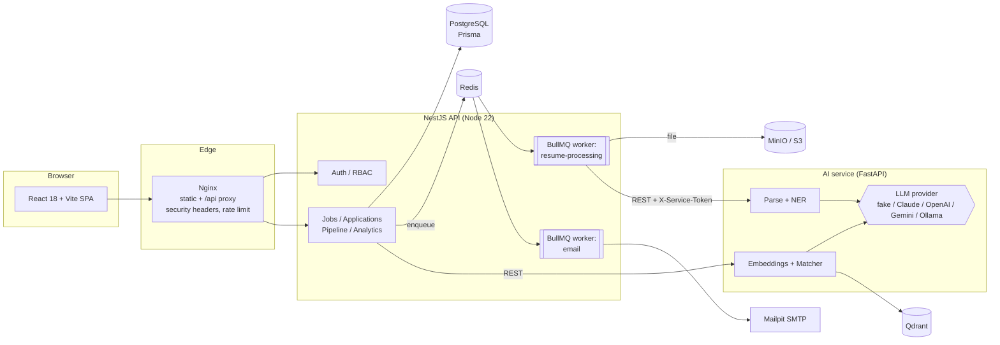

# HireLens — AI Resume Screener & Job-Match Platform

HireLens is a two-sided hiring platform. **Recruiters** post jobs and get AI-ranked candidates, each
with an explainable match score. **Candidates** upload a resume and get AI feedback on how to improve it.

It runs fully offline by default. A deterministic "fake" LLM provider and lightweight CPU models mean
`docker compose up` gives a complete, seeded demo with **zero API keys**. Real LLMs (Anthropic Claude,
OpenAI, Gemini, Ollama) are one env var away.

## Features

| # | Feature | Where |
|---|---------|-------|
| 1 | Resume upload (PDF/DOCX/TXT). AI extracts name, contact, skills, experience, education, projects and years of experience as validated JSON. Parsing runs asynchronously on a BullMQ worker. | `ml/app/services/resume_parser.py`, `backend/src/resumes` |
| 2 | Job postings with automatic **required vs nice-to-have** skill extraction, minimum years and seniority, editable before publishing | `ml/app/services/job_analyzer.py`, `frontend/src/pages/recruiter/JobFormPage.tsx` |
| 3 | Semantic matching: Qdrant vectors + skill overlap + experience fit, with an **explainable score breakdown** | `ml/app/services/matcher.py` |
| 4 | Ranked candidate list per job, with filters for score, skills, location, experience and stage | `backend/src/applications`, `CandidatesPage.tsx` |
| 5 | Candidate feedback: ATS score from a weighted checklist, missing keywords for a target job, rewritten bullet points | `ml/app/services/feedback.py`, `FeedbackPage.tsx` |
| 6 | Interview questions tailored to the resume and the job (technical, experience, gaps, behavioural) | `ml/app/services/interview.py` |
| 7 | **Blind screening.** Name, contact, photo, gender and age signals are hidden during Applied/Screening and revealed at Interview | `backend/src/applications/anonymize.ts`, `redaction.py` |
| 8 | Kanban pipeline (Applied → Screening → Interview → Offer → Rejected) with drag & drop and an accessible stage menu | `PipelinePage.tsx` |
| 9 | Email notifications through a queue (Nodemailer → Mailpit locally), with retries and an audit log | `backend/src/notifications` |
| 10 | Recruiter analytics: applicants per job, average match score, time-to-hire, funnel, score distribution, trends, top skills | `backend/src/analytics`, `DashboardPage.tsx` |

Platform features:
- JWT auth with rotating refresh tokens and reuse detection
- RBAC with three roles (candidate, recruiter, admin) and an admin console
- Rate limiting, structured logs, a global error filter
- Swagger docs, health checks
- Dark/light mode and a responsive, accessible UI

## Architecture



**Request flow, apply to a job:**
1. The SPA calls `POST /api/jobs/:id/applications`.
2. NestJS checks the role, the resume status and duplicates.
3. It calls the AI service's `/v1/match`. The AI service fetches the job and resume vectors from
   Qdrant (or embeds the text if they are missing) and computes the weighted score and breakdown.
4. NestJS stores the application and its first pipeline event in Postgres.
5. Two emails are enqueued, one to the candidate and one to the recruiter.

The service-to-service contract is documented in OpenAPI:
[`docs/ai-service.openapi.json`](docs/ai-service.openapi.json) (AI service) and
[`docs/backend.openapi.json`](docs/backend.openapi.json) (public API).

## Tech stack

| Layer | Technology |
|-------|------------|
| Frontend | React 18, Vite 7, TypeScript, Tailwind CSS v4, shadcn/ui-style components (Radix), React Router 6, TanStack Query, React Hook Form + Zod, Recharts, dnd-kit, sonner |
| Backend | Node.js 22, NestJS 11, TypeScript, Prisma 6, BullMQ 5, class-validator, nestjs-pino, @nestjs/throttler, helmet, Swagger |
| AI service | Python 3.12, FastAPI, Pydantic v2, spaCy (optional) with a rule-based NER fallback, sentence-transformers all-MiniLM-L6-v2 (optional) with a hashing-embedding fallback, pypdf, python-docx, qdrant-client, official `anthropic` / `openai` / `google-genai` SDKs |
| Data | PostgreSQL 16, Qdrant 1.13, Redis 7, MinIO (S3-compatible) |
| Auth | JWT access tokens + rotating httpOnly refresh cookie; roles `CANDIDATE`, `RECRUITER`, `ADMIN` |
| Email | Nodemailer → Mailpit (local) / any SMTP |
| DevOps | Docker (multi-stage, non-root), Docker Compose, Nginx (unprivileged), GitHub Actions |
| Testing | pytest + coverage, Jest + Supertest (real Postgres/Redis), Vitest + Testing Library, Playwright |

## Screenshots

> _Placeholder: add screenshots of the recruiter dashboard, ranked candidates with score breakdown,
> Kanban pipeline and candidate feedback page._

## Local setup

Prerequisites: Docker Desktop. For running outside Docker you also need Node 22+ and
[uv](https://docs.astral.sh/uv/).

```bash
cp .env.example .env            # optional; every value has a local default
docker compose up -d --build    # builds 3 images, starts 8 services, migrates + seeds the DB
open http://localhost:20200
```

Demo accounts (password `Password123!`):

| Role | Email |
|------|-------|
| Candidate | `candidate@hirelens.dev` |
| Recruiter | `recruiter@hirelens.dev` (also `talent@hirelens.dev`) |
| Admin | `admin@hirelens.dev` |

The seed contains 8 candidates with parsed resumes, 5 jobs (2 with blind screening) and 16
applications spread across every pipeline stage, with time-to-hire data.

| Service | URL |
|---------|-----|
| Web app | http://localhost:20200 |
| API + Swagger UI | http://localhost:20201/api/docs |
| AI service docs | http://localhost:20202/docs |
| Mailpit inbox | http://localhost:20216 |
| MinIO console | http://localhost:20214 |
| Qdrant dashboard | http://localhost:20212/dashboard |

Run a scripted end-to-end check of every feature against the running stack:

```bash
bash scripts/smoke.sh
```

### Developing services individually

```bash
# infra only
docker compose up -d postgres redis qdrant minio mailpit

# AI service
cd ml && uv sync -p 3.12 && AI_QDRANT_URL=http://localhost:20212 uv run uvicorn app.main:app --port 20202 --reload

# backend (reads backend/.env; see .env.example for variables)
cd backend && npm ci && npx prisma migrate deploy && npm run start:dev

# frontend (proxies /api to :20201)
cd frontend && npm ci && npm run dev    # http://localhost:20203
```

### Tests

```bash
cd ml && uv run pytest                      # 71 tests, ~98% coverage, no network, no keys
cd backend && npm run test:cov              # 57 tests, ~99% lines; needs postgres+redis from compose (DB hirelens_test)
cd frontend && npm run test:cov             # 39 component tests
cd frontend && npx playwright test          # 2 e2e specs against the running compose stack
```

## Environment variables

| Variable | Service | Default | Description |
|----------|---------|---------|-------------|
| `POSTGRES_USER` / `POSTGRES_PASSWORD` / `POSTGRES_DB` | postgres, backend | `hirelens` | Database credentials |
| `DATABASE_URL` | backend | built from the above | Prisma connection string |
| `REDIS_URL` | backend | `redis://redis:6379` | BullMQ connection |
| `JWT_ACCESS_SECRET` | backend | dev value | **Required in prod**, ≥16 chars. Signs access tokens |
| `JWT_ACCESS_TTL` | backend | `15m` | Access-token lifetime (`s`/`m`/`h`/`d`) |
| `REFRESH_TOKEN_TTL_DAYS` | backend | `7` | Refresh-token lifetime |
| `COOKIE_SECURE` | backend | `false` | Set `true` behind HTTPS |
| `CORS_ORIGINS` | backend | `http://localhost:20200` | Comma-separated allow-list |
| `APP_URL` | backend | `http://localhost:20200` | Used in email links |
| `SEED_ON_START` | backend | `true` | Seed demo data when the DB has no jobs |
| `THROTTLE_LIMIT` / `THROTTLE_TTL_MS` | backend | `300` / `60000` | Global rate limit per IP |
| `MAX_UPLOAD_BYTES` | backend | `5242880` | Resume size limit |
| `S3_ENDPOINT` / `S3_BUCKET` / `S3_ACCESS_KEY` / `S3_SECRET_KEY` / `S3_REGION` / `S3_FORCE_PATH_STYLE` | backend | MinIO values | Resume file storage. Omit `S3_ENDPOINT` for AWS |
| `SMTP_HOST` / `SMTP_PORT` / `SMTP_USER` / `SMTP_PASS` / `MAIL_FROM` | backend | Mailpit | Outgoing email |
| `AI_SERVICE_URL` / `AI_SERVICE_TOKEN` / `AI_TIMEOUT_MS` | backend, ai | `http://ai:8000` / dev token / `20000` | Service-to-service call + shared secret |
| `AI_LLM_PROVIDER` | ai | `fake` | `fake`, `anthropic`, `openai`, `gemini`, `ollama` |
| `AI_ANTHROPIC_API_KEY` / `AI_ANTHROPIC_MODEL` | ai | — / `claude-opus-5-5` | Claude via the official SDK, JSON-schema structured output |
| `AI_OPENAI_API_KEY` / `AI_OPENAI_MODEL` | ai | — / `gpt-4o-mini` | OpenAI structured outputs |
| `AI_GEMINI_API_KEY` / `AI_GEMINI_MODEL` | ai | — / `gemini-2.0-flash` | Google Gemini |
| `AI_OLLAMA_BASE_URL` / `AI_OLLAMA_MODEL` | ai | `http://host.docker.internal:11434` / `llama3.1` | Local models |
| `AI_EMBEDDING_PROVIDER` | ai | `hashing` | `hashing` (CPU, no download) or `sentence-transformers` (all-MiniLM-L6-v2) |
| `AI_NER_PROVIDER` | ai | `auto` | `auto` (spaCy if installed), `rule`, `spacy` |
| `AI_INSTALL_ML_EXTRAS` | build arg | `false` | Bake spaCy + sentence-transformers into the AI image |
| `AI_QDRANT_URL` | ai | `:memory:` (tests) / `http://qdrant:6333` | Vector store |
| `AI_WEIGHT_SEMANTIC` / `AI_WEIGHT_SKILLS` / `AI_WEIGHT_EXPERIENCE` | ai | `0.45` / `0.40` / `0.15` | Match-score weights (normalised) |

## API docs

- Public REST API: Swagger UI at `http://localhost:20201/api/docs` (JSON at `/api/docs-json`). A snapshot
  is in [`docs/backend.openapi.json`](docs/backend.openapi.json). Regenerate it with `npm run openapi:export`.
- Internal AI service: `http://localhost:20202/docs`. A snapshot is in
  [`docs/ai-service.openapi.json`](docs/ai-service.openapi.json). Regenerate it with
  `uv run python scripts/export_openapi.py`.

## Deployment guide

The images are stateless 12-factor containers, so any container platform works (ECS/Fargate, Cloud Run,
Fly.io, Kubernetes).

1. **Managed data services.** Use managed PostgreSQL (RDS/Cloud SQL), Redis (ElastiCache/Memorystore),
   Qdrant Cloud (or self-hosted) and S3. Set `S3_ENDPOINT` empty and `S3_FORCE_PATH_STYLE=false` for AWS S3.
2. **Secrets.** Inject them from a secret manager: `JWT_ACCESS_SECRET` (`openssl rand -base64 48`),
   `AI_SERVICE_TOKEN`, DB/SMTP/S3 credentials, and the LLM key. Set `COOKIE_SECURE=true`, a restrictive
   `CORS_ORIGINS`, and `SEED_ON_START=false`.
3. **Images.** Build with `docker compose build` (or the CI `docker-e2e` job) and push to your registry.
   The backend container runs `prisma migrate deploy` before starting. To avoid racing migrations when you
   run several replicas, run migrations as a one-off job instead.
4. **Topology.** Put the `web` (Nginx) image, or a CDN serving `frontend/dist`, behind your load balancer
   with TLS. Route `/api` to the backend. Keep the AI service on a private network: it is protected by
   `X-Service-Token` and must not be exposed publicly.
5. **Scaling.** API replicas scale horizontally (stateless JWT, queues in Redis). BullMQ workers run inside
   the API process. To scale them on their own, run the same image with more replicas. The AI service scales
   on CPU. Enable `AI_INSTALL_ML_EXTRAS` with `AI_EMBEDDING_PROVIDER=sentence-transformers` for semantic
   embeddings, and re-index after switching models.
6. **Observability.** Logs are JSON (pino/structlog) with request ids propagated via `x-request-id`.
   `/api/health` reports database, Redis, AI service and storage status, and returns 503 only when a
   critical dependency is down.

## What I learned / Key engineering decisions

The full rationale is in [`docs/DECISIONS.md`](docs/DECISIONS.md). The highlights:

- **Deterministic core, LLM at the edges.** Every AI task first builds a rule-based draft. The default
  `fake` provider returns it, and real LLMs refine it under a JSON schema with Pydantic validation, a retry
  and a fallback. Scores (match and ATS) are always computed in code, which keeps them auditable,
  reproducible and immune to prompt injection inside resumes.
- **Explainability as a feature.** Each score stores its component values, weights, matched/missing
  skills and a plain-English explanation, and the UI shows it on demand.
- **Bias mitigation by design.** Blind screening is a per-job setting enforced server-side and gated by
  pipeline stage. Redaction happens once in the AI service, and graduation years (an age proxy) are dropped.
- **Async where it matters.** Resume parsing and email are queued with retries. A recovery sweeper makes
  sure no resume is stuck in `PROCESSING` after a crash. Matching stays synchronous so candidates see
  their score instantly.
- **Security details.**
  - Refresh-token rotation with family revocation on reuse.
  - Single-winner concurrent refresh.
  - Magic-byte file sniffing.
  - Tenant checks on every recruiter action.
  - Strict DTO whitelisting.
  - Non-root containers, a CSP and rate limiting at two layers.
- **Testability.** Each external dependency sits behind a port (`AiClient`, `ObjectStorage`, `Mailer`,
  `LLMProvider`, `Embedder`, `NERProvider`). Integration tests run against real Postgres and Redis with
  in-process fakes for the rest. Provider SDKs are tested with `httpx2.MockTransport`.
